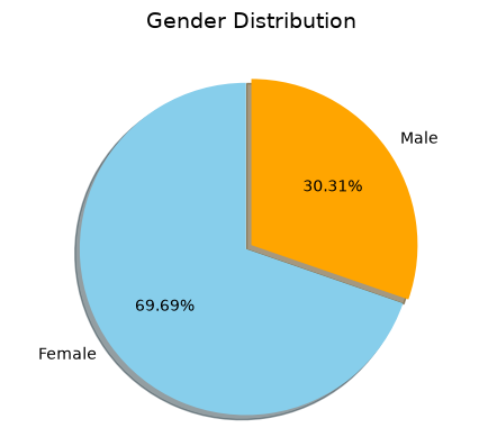

# 📊 Sales Data Analysis – Exploratory Data Analysis (EDA) Using Python

## Project Overview
This project focuses on Exploratory Data Analysis (EDA) of sales data using Python to understand customer behaviour, sales trends, and product performance.

## 🛠️ Tools & Technologies
- Python
- Jupyter Notebook
- Pandas & NumPy
- Matplotlib & Seaborn

## 📈 Key Analysis
- Gender-wise transactions and sales
- Age group-wise sales analysis
- Top 5 states by sales and quantity
- Product category-wise analysis
- Profession-wise transactions and sales
- Top 10 products by quantity ordered

 

## 📂 Project Files
- `Analysis on Sales Data.ipynb` – Main notebook
- `Sales_Data.csv` – Dataset
- PNG files – Data visualizations
- EDA Project PDF – Documentation

## 🎯 Learning Outcomes
- Data cleaning and manipulation
- Exploratory Data Analysis
- Data visualization
- Identifying sales patterns and insights

## 👩‍💻 Author
**Mansi**  
Aspiring Data Analyst
